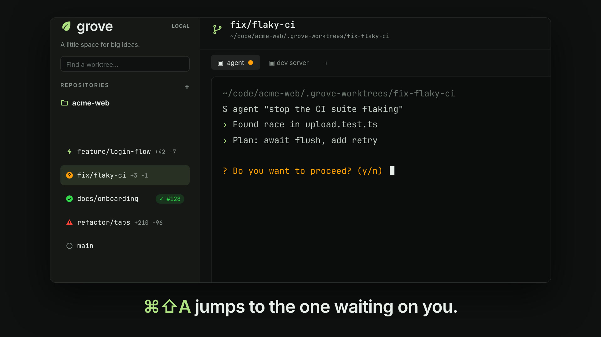

# Grove

[](https://github.com/s96Abrar/grove/actions/workflows/ci.yml)
[](https://github.com/s96Abrar/grove/actions/workflows/security.yml)


[](LICENSE)


**Six coding agents on one repo. Grove gives each its own worktree, and ⌘⇧A jumps to the one waiting on you.**

[](brag-output/brag.mp4)

<sub>▶ Click to watch the 21-second launch video. The repository, branches and agent output shown are illustrative.</sub>

### Why Grove

- **Every task gets its own worktree:** a branch, a terminal and tabs per task, side by side in one window.
- **It spots the agent waiting on you:** a "Do you want to proceed?" prompt or `(y/n)` turns the worktree into an orange question mark, and ⌘⇧A jumps straight to it.
- **Sessions survive Quit:** tmux-backed shells keep running and reattach when you reopen Grove.
- **Native and small:** an 8.6 MB SwiftUI/AppKit app with no web runtime, no telemetry, no account and no activation. MIT-licensed.

An independent native macOS coding workspace: embedded interactive terminals, Git worktrees, tabs and nested splits. Grove's own code is MIT-licensed. It has no telemetry, account requirement or license activation; no Supacode code, artwork or services are adopted. Terminal rendering uses MIT-licensed SwiftTerm with a pinned dependency lockfile.


Build and open locally:

```sh
brew install tmux
make build
open dist/Grove.app
```

Development needs macOS, Xcode with Swift 6.2+, Python 3.9+, system Git and tmux for persistent sessions. System screen is used only to reconnect legacy sessions. The app targets macOS 14+; supported-version runtime testing remains part of the release checklist. Python is not needed by the main app, but is needed for build/release tooling and the optional CLI. Coding agents are installed and authenticated separately.

Use Command-O to add a repository/folder, Command-N to create a worktree, Shift-Command-T for a terminal tab, and Shift-Command-P for commands. Tabs support interactive shells/agents, nested splits, rename/reorder, terminal search and saved active-tab selection. Custom scripts, pin/archive controls, file browsing, tracked Git diffs and opt-in manual GitHub lookup are included. Branch rename and guarded removal are in the worktree context menu.

Tmux-backed sessions survive ordinary app termination and reattach to the same shell. Existing live screen sessions are preserved until explicitly closed; new persistent panes use tmux. Confirmed **tab closure ends that tab's sessions**. Ordinary Quit preserves persistent sessions; “Quit and End Grove Sessions” stops saved sessions. Workspace metadata is validated and backed up before replacement, with corrupt data preserved for recovery. A Settings reset clears workspace metadata without deleting repositories/worktrees.

```sh
make check                           # checks plus isolated GUI app restart
make package                         # host-architecture local-only ZIP
GROVE_ARCHS="arm64 x86_64" make package  # universal local-only ZIP
```

The accepted release policy intentionally uses ad-hoc signatures and skips Apple signing/notarization. Tagged-only releases still require clean source, universal binaries, bundle/archive validation and checksums. Apple credentials are not a release prerequisite or outstanding issue. Releases are built and published as GitHub Releases by the release workflow when a version tag is pushed. [Release policy](docs/RELEASING.md) · [Agent instructions](AGENTS.md).

## Performance

Grove is a native SwiftUI/AppKit app with no web runtime, background services or telemetry. Measure it on your own Mac:

```sh
make build
make perf            # or: python3 scripts/perf.py --runs 10 --json perf.json
```

`scripts/perf.py` launches the built app several times in an isolated test workspace (your real workspace, preferences and tmux sessions are not touched) and reports the median and range of:

| Metric | What it measures |
|---|---|
| Launch to interactive terminal | Process start until the first terminal pane has started its PTY, tmux session and login shell and run a command. Includes your shell's startup time. |
| Memory (RSS) at idle | Resident memory a few seconds after launch, one terminal open. |
| CPU at idle | Average CPU over a quiet sampling window. |
| App bundle / executable size | Size on disk. |

Every CI run on `main` and on pull requests measures the freshly built app on a GitHub-hosted Apple Silicon runner and shows the table in the run summary ([Quality checks](https://github.com/s96Abrar/grove/actions/workflows/ci.yml)). Hosted runners are shared virtual machines, so treat those numbers as a regression signal rather than a benchmark of a real Mac.

Latest recorded run (Grove 0.3.0, [CI run of 2026-11-26](https://github.com/s96Abrar/grove/actions/runs/45858153144) on an Apple M1 virtual machine, 7 GB, macOS 26.7; median of 3 runs):

| Metric | Median | Range |
|---|---|---|
| Launch to interactive terminal | 1074 ms | 824–1238 ms |
| Memory (RSS) at idle | 125 MB | 124–125 MB |
| CPU at idle | 0.8 % | 0.2–1.0 % |
| App bundle size | 8.6 MB | |
| Executable size | 7.5 MB | |

This is not full Supacode parity. SSH workspaces, agent hooks, notification inbox, full forge controls, pane/divider-state restoration and automatic updates remain tracked in the [feature matrix](docs/FEATURE-PARITY.md).

[Documentation](docs/README.md) · [User guide](docs/USER-GUIDE.md) · [Release policy](docs/RELEASING.md) · [Validation](docs/VALIDATION.md) · [Privacy](docs/PRIVACY.md) · [Changelog](CHANGELOG.md) · [License](LICENSE)

[Contributing](CONTRIBUTING.md) · [Code of conduct](CODE_OF_CONDUCT.md) · [Security policy](SECURITY.md) · [Support](SUPPORT.md)
