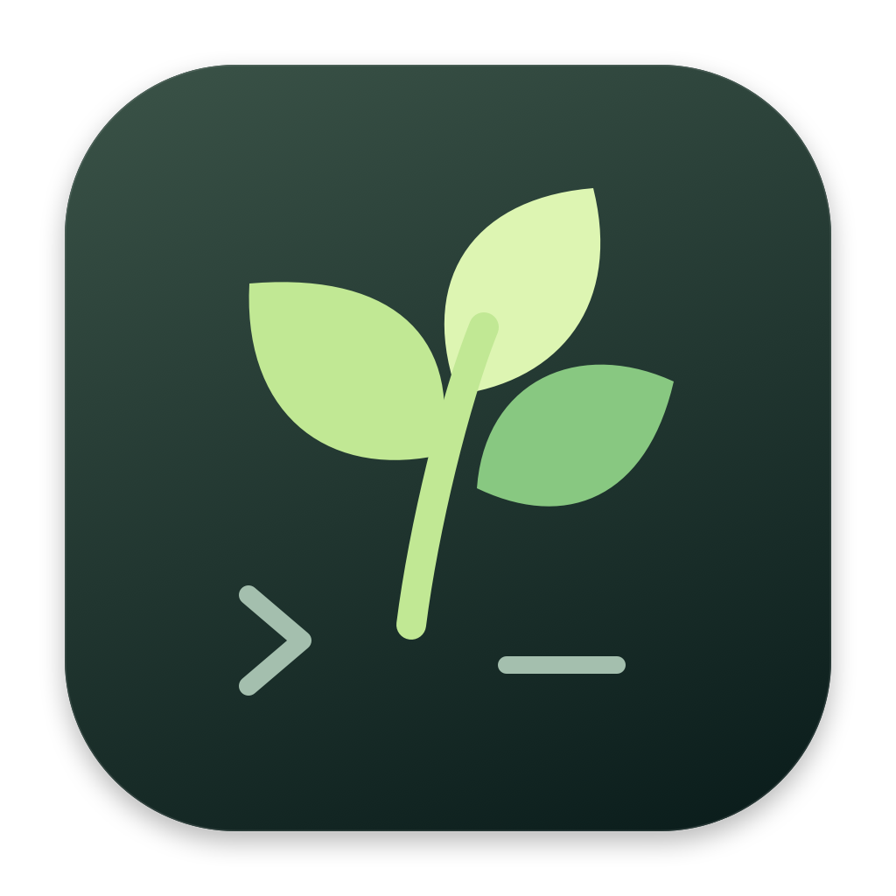

# Grove

An independent native macOS coding workspace: embedded interactive terminals, Git worktrees, tabs and nested splits. Grove's own code is MIT-licensed. It has no telemetry, account requirement or license activation; no Supacode code, artwork or services are adopted. Terminal rendering uses MIT-licensed SwiftTerm with a pinned dependency lockfile.



Build and open locally:

```sh
brew install tmux
make build
open dist/Grove.app
```

Development needs macOS, Xcode with Swift 6.2+, Python 3.9+, system Git and tmux for persistent sessions. System screen is used only to reconnect legacy sessions. The app targets macOS 14+; supported-version runtime testing remains part of the release checklist. Python is not needed by the main app, but is needed for build/release tooling and the optional CLI. Coding agents are installed and authenticated separately.

Use Command-O to add a repository/folder, Command-N to create a worktree, Shift-Command-T for a terminal tab, and Shift-Command-P for commands. Tabs support interactive shells/agents, nested splits, rename/reorder, terminal search and saved active-tab selection. Custom scripts, pin/archive controls, file browsing, tracked Git diffs and opt-in manual GitHub lookup are included. Branch rename and guarded removal are in the worktree context menu.

Tmux-backed sessions survive ordinary app termination and reattach to the same shell. Existing live screen sessions are preserved until explicitly closed; new persistent panes use tmux. Confirmed **tab closure ends that tab's sessions**. Ordinary Quit preserves persistent sessions; “Quit and End Grove Sessions” stops saved sessions. Workspace metadata is validated and backed up before replacement, with corrupt data preserved for recovery. A Settings reset clears workspace metadata without deleting repositories/worktrees.

```sh
make check                           # checks plus isolated GUI app restart
make package                         # host-architecture local-only ZIP
GROVE_ARCHS="arm64 x86_64" make package  # universal local-only ZIP
```

The accepted release policy intentionally uses ad-hoc signatures and skips Apple signing/notarization. Tagged-only releases still require clean source, universal binaries, bundle/archive validation and checksums. Apple credentials are not a release prerequisite or outstanding issue. No remote is configured and no hosted CI/release has run. [Release policy](docs/RELEASING.md) · [Agent instructions](AGENTS.md).

This is not full Supacode parity. SSH workspaces, agent hooks, notification inbox, full forge controls, pane/divider-state restoration and automatic updates remain tracked in the [feature matrix](docs/FEATURE-PARITY.md).

[Documentation](docs/README.md) · [User guide](docs/USER-GUIDE.md) · [Release policy](docs/RELEASING.md) · [Validation](docs/VALIDATION.md) · [Privacy](docs/PRIVACY.md) · [Changelog](CHANGELOG.md) · [License](LICENSE)

[Contributing](CONTRIBUTING.md) · [Code of conduct](CODE_OF_CONDUCT.md) · [Security policy](SECURITY.md) · [Support](SUPPORT.md)
