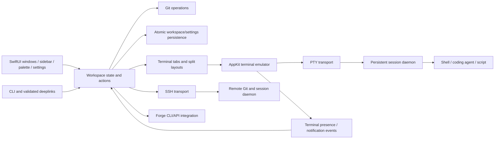

# Grove architecture

This document separates the original implementation from the design needed for Supacode-like coverage. Implementation claims should be checked against [feature coverage](FEATURE-PARITY.md) and [validation](VALIDATION.md). The source reference is pinned in [the investigation](SUPACODE-EVIDENCE.md).

## Current independent implementation (0.3)

`Sources/Grove/Grove.swift` composes SwiftUI windows, sidebar/detail views, worktree creation, change review and terminal tabs. `Workspace.swift` owns selected workspace state, async Git operations, local folder/repository roster, pin/archive sets, scripts, cloning, manual GitHub lookup and deeplink dispatch. `Settings.swift` contains General/Scripts/Help settings and the subsequence command palette. `FileBrowser.swift` provides nonhidden directory navigation and system-default opening.

`Git.swift` executes system Git with explicit argv and parses NUL-delimited worktree records. Worktree creation validates the branch, optionally fetches/prunes, resolves the configured base ref to a commit, writes a sibling checkout and asks Git for canonical path identity. Branch rename delegates to validated Git branch -m. Removal rejects the main checkout and tracked/untracked dirty state before asking Git to remove the checkout; it keeps the branch. Selected Git status/diff and the local roster refresh periodically while active. Worktree removal performs a non-destructive Git eligibility check before stopping sessions, then rechecks Git before deleting the checkout. Only successful removal evicts cached sessions and metadata. Failed creation removes only its owned checkout/registration through Git; locked/refused checkouts are preserved with recovery errors. Branches, including hook-created commits, and unrelated registrations are retained.

`Session.swift` adapts MIT-licensed SwiftTerm’s AppKit `LocalProcessTerminalView` to SwiftUI. It launches a PTY login shell or script. Persistent mode uses [PersistentTerminal.swift](../Sources/Grove/PersistentTerminal.swift) to create and attach to a session on the isolated `tmux -L grove` server using the pane UUID. Live legacy screen sessions are detected and reattached without replacing their processes. The packaged tmux.conf supplies terminal capabilities, disables the prefix/status bar and does not load the user configuration. tmux is an external runtime dependency. Session views are cached by that UUID. This is real interactive terminal input; it does not use the old EOF-on-stdin command console or require Terminal.app.

Workspace state is Codable data in UserDefaults `workspace.v2`, with fallback to the original repository root list. It includes roots, selected worktree path, tabs/panes with stable IDs, recursive `SplitNode` layout, pins, archives and script definitions. General preferences, including baseRef and fetchBeforeCreate, use AppStorage. Active tab selection and repository disclosure states persist; pane focus and divider geometry remain transient. Validation retains last-good/unreadable snapshots and blocks overwriting unrecoverable metadata.

The split view recursively renders horizontal/vertical native split containers. Tab context menus rename or reorder within a worktree. Fixed shortcuts expose indexed worktree jumps and native terminal find. Confirmed tab closure ends its sessions before removing metadata; ordinary quit preserves persistent shells. Explicit end-sessions-and-quit targets saved IDs but surfaces cleanup failures.

`scripts/grove` is a Python CLI that opens validated action URLs through Launch Services, reads saved metadata through `defaults export`, or lists the Grove tmux server and legacy screen sessions. It is not a live app RPC protocol. GitHub integration is opt-in/manual `gh pr view` JSON; no telemetry client is included.

The legacy PTY/screen and current tmux integration checks establish interactive input and stable shell PID across detach/reattach. It does not yet establish every GUI terminal lifetime, full app relaunch, scrollback or agent-specific behavior. The Git integration fixture additionally passed explicit base ref selection, branch rename, dirty/main removal rejection and clean removal. See [validation](VALIDATION.md) and [testing](TESTING.md).

## Target design

The following are design responsibilities, not assertions that all components have shipped. Keep responsibilities cohesive and introduce separate modules only when real callers need them.

### Identity and ownership

A workspace item identifies a local folder/repository or a remote host plus path. A worktree belongs to one repository and has an immutable location identity; branch names are mutable metadata. A tab has a stable UUID, a title override, a selected surface and a recursive split layout. Each terminal surface owns one stable session ID. Session identity must survive moving tabs, changing focus and renaming a branch.

Distinguish Git worktrees from synthetic plain-folder items. Distinguish local paths from remote paths at the type boundary: remote paths must not reach local FileManager calls. Resolve physical paths consistently with Git before matching newly created worktrees.

### Terminal lifetime

The view renders a terminal; it does not own the shell’s durable lifetime. An AppKit terminal adapter handles input, output, resize, paste, search, selection and escape sequences. A PTY supplies terminal semantics. The current backend uses an external tmux executable to own new persistent shells, retaining legacy screen reattachment; full retained-scrollback behavior still needs app-level acceptance. Persisting tab metadata alone does not implement process persistence.

Close, detach and terminate are separate actions. Normal app quit should detach when persistence is enabled. Explicit teardown should terminate only Grove-owned sessions. A session launch failure must remain visible and retryable rather than creating a duplicate process on every redraw. Keep the emulator view associated with stable surface identity so navigation does not restart the shell.

Grove has selected the MIT-licensed SwiftTerm, pinned to the exact release `1.99.2` (revision `a183c15`), as its independent terminal renderer; upstream uses Ghostty. Renderer choice can provide equivalent workflows without claiming compatibility with every Ghostty-specific setting. The renderer and session backend need independent acceptance checks.

### State persistence

Persist versioned workspace metadata and settings through atomic writes. Include repositories/folders, remote connection references, selected worktree/tab/surface, split tree, pinned/archived state and timestamps, script definitions and user appearance choices. Do not serialize a process object, PTY handle or view.

Migrate the existing `repositories` UserDefaults value once without losing the saved roots. Treat malformed or future-version data as a recoverable load failure; preserve the original file before replacing it. Do not silently reset the whole workspace when one script or customization is invalid.

### Git and files

Use Git’s own validation and machine-readable output. Execute mutations with explicit argv, preserve meaningful error output, and refresh the actual roster after success. Never infer a successful checkout from a button click. Keep dirty-worktree checks and main-checkout protection in the shared removal operation used by UI, CLI and automated cleanup.

Creation options include base ref/directory, fetch, copy policies and lifecycle script. Copy plans need clear containment, symlink and collision behavior. File discovery must handle disappearing paths and must not mistake untracked files for tracked diff contents.

### Scripts and automation

Global and repository script definitions contain stable IDs, names, command text and appearance. Lifecycle scripts have distinct triggers from user-invoked scripts. Script execution is deliberately capable of running user code; show where it will run and preserve its outcome.

CLI requests, deeplinks and UI actions should converge on the same validation and operations. Export contextual identifiers into each session. A deeplink should not silently become an unrestricted shell-input channel. Separate command acceptance from eventual execution success, use request IDs/timeouts and report stale-version responses clearly.

### Remote and forge integration

SSH transport owns connection reuse, host identity and reconnect state. Authentication remains with the user’s SSH setup. Reconnection should reattach to a known remote session; replaying the last command risks duplicate side effects. Report reduced local-only capabilities explicitly.

Forge adapters normalize PR/MR state, checks, reviews and merge readiness while preserving missing/unknown data. Use installed authenticated CLI credentials without copying tokens into workspace files. Current Grove uses opt-in manual GitHub CLI reads only. Read polling and write actions need separate paths. A configured integration is not proof of successful authentication or access.

### Agent presence and notifications

Consume a defined per-surface presence protocol. In inspected upstream source, hooks emit OSC 3008 through the terminal and the Unix socket carries CLI control. Do not infer “awaiting input” merely from output silence or a process name. Bound and validate escape-sequence payloads, preserving ordinary terminal output.

Current Grove (v0.4) has no hook protocol yet. It marks a pane as awaiting input from two signals: an OSC 7501 program status of `blocked`, and explicit prompt text in the bottom rows of the visible screen (`AgentPrompt`, read through SwiftTerm's copied `visibleRowsText`), with interrupt hints and a trailing shell prompt ruling a match out. The text is matched in memory and never stored. Optional notifications (`AttentionNotifier`) post once per arrival, skip the active worktree, honor per-worktree mute and carry only branch and repository names.

Notification events retain target surface/worktree identity. Apply user mute, sound, active-surface, filtering and retention choices before delivery. Permission denial must not prevent in-app notifications or terminal use.

## Concurrency and failure behavior

Keep view state on the main actor and blocking Git/network operations off it. Avoid duplicate refresh work per root; discard stale results after selection or repository removal. Cancellation must not label an operation successful, and an SSH timeout must not imply that a remote mutation did not occur. Preserve enough operation context to reconcile actual state before retrying.

Background activity should not create repeated alert dialogs for an unavailable repository. Represent persistent connection/auth/path problems in the relevant workspace row, with an explicit retry action.

## Distribution

Local and tagged distribution intentionally uses ad-hoc-signed, non-notarized builds under the accepted release policy. A production updater needs Grove’s own bundle identity, signing configuration, keys and feeds; upstream infrastructure is not Grove’s release infrastructure. Document dependency notices and preserve upstream license/copyright notices if upstream code is adopted.

## Independence and privacy

The user selected an independent implementation. No Supacode source or assets should be copied into Grove. Pinned upstream links document observed requirements, not adopted implementation. Grove excludes analytics and crash-report uploads by design; see [privacy](PRIVACY.md). Feature parity therefore deliberately does not include upstream telemetry.

## Release hardening in 0.3

WorkspaceState.swift holds Foundation-only Codable models, validation and last-good/unreadable snapshot handling. Active tab selection is persisted; pane focus/divider geometry are still separate gaps. Workspace.swift owns async lifecycle/deeplink sequencing and reports cleanup failures. The session cache no longer publishes mutations during SwiftUI view construction.

release.json supplies package version/build/identity. The package builder stages a new bundle, installs all icon resolutions and notices, records source provenance, signs with hardened runtime and verifies before replacing generated output. Tagged release mode requires a matching clean tag, universal architectures and integrity/archive validation. Apple signing/notarization are excluded; manifests distinguish local-adhoc from tagged-adhoc output. No remote or update/telemetry service is introduced. See [Releasing](RELEASING.md).

## UI/UX branch corrections

[Branch review](UIUX-BRANCH-REVIEW.md) records the review of commits `73977e3` and `c72a4eb` against `main` (`5e88023`). `PerformanceProfile` schedules both Auto downgrade and recovery; the palette keeps identity separate from shortcut text and scopes navigation to its query window. Stable triage status requires two consecutive samples and is optional behind the existing preference; pins retain priority. ChangesDiffView handles unified/split tracked diffs, Git-quoted paths, binary and metadata-only entries, and side-specific line numbers. The restored-pane notice describes loaded metadata; it does not establish daemon continuity.
